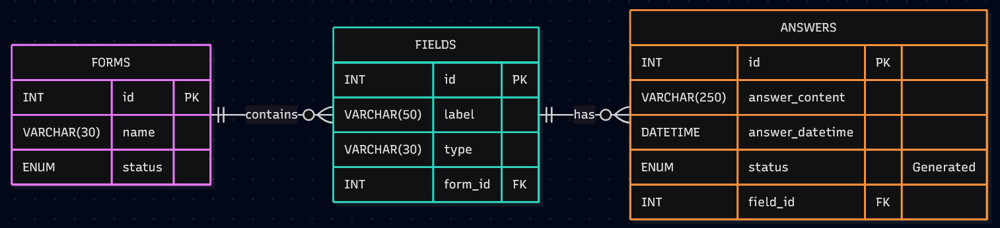

# ExerciseLooper — Documentation technique

**Version documentée :** prérelease `0.0.2`  
**Module :** MAW11 — Exercise Looper  
**Dépôt GitHub :** https://github.com/KT539/MAW11_LooperProject_V2  
**Statut :** Le projet étant encore en cours de développement, cette documentation n'est pas définitive et encore sujette à modification.

---

## 1. Présentation du projet

### 1.1. Membres de la Scrum Team

| Nom | Rôle |
|---|---|
| Pascal Hurni | Product Owner |
| Nicolas Glassey | Scrum Master |
| Kilian Testard | Développeur |
| Ryan Bersier | Développeur |
| Gaetan Gendroz | Développeur |

### 1.2. Contexte et objectifs

Le projet Looper est une application web de création, de remplissage et de gestion d'exercices sous forme de formulaires, développé dans le cadre du cours MAW11. L'objectif du projet est de reproduire à l'identique le site modèle <https://exercice-looper.mycpnv.ch>, en recréant entièrement le backend de l'application en Ruby.  
À noter que le cahier des charges prévoyait initialement de développer le projet avec PHP.

### 1.3. Périmètre fonctionnel de la version 0.0.2

L'application permet de créer des exercices, d'y ajouter des questions, de modifier ou supprimer ces questions, d'ouvrir un exercice aux réponses, de recueillir des soumissions, d'afficher leurs résultats, de clôturer et de supprimer des exercices.

Chaque exercice possède l'un des trois statuts suivants :

| Statut | Signification | Actions principales dans l'interface |
|---|---|---|
| `Building` | Exercice en cours de construction | Ajouter, modifier et supprimer des champs ; ouvrir l'exercice aux réponses |
| `Answering` | Exercice ouvert aux réponses | Remplir l'exercice, consulter les résultats, clôturer l'exercice |
| `Closed` | Exercice clôturé | Consulter les résultats, supprimer l'exercice |

Les champs acceptés sont `single_line` (texte sur une ligne), `single_line_list` (liste de lignes) et `multi_line` (texte multiligne). Dans l'implémentation actuelle du projet, seul `single_line` produit un `<input>` : les deux autres types sont affichés avec un `<textarea>`.

### 1.4. Objet de ce document

Ce document décrit **le fonctionnement du code existant**. Il doit permettre à un successeur de mettre en place le projet, de trouver le bon fichier à modifier, de comprendre le cheminement d'une requête HTTP jusqu'à MySQL, et de connaître les principales limites techniques avant toute évolution.


## 2. Stack technique et environnement

| Élément | Technologie | Utilisation |
|---|---|---|
| Langage serveur | Ruby 3.3 ou supérieur | Langage du backend de l'application |
| Microframework web | Sinatra 4 | Contrôleurs, routes HTTP, rendu ERB |
| Interface utilisateur | HTML, CSS et ERB | Génération des pages |
| Serveur et interface HTTP | Rack, `rackup`, Puma | Démarrage et traitement des requêtes |
| Persistance | MySQL avec `mysql2` | Stockage des exercices, champs et réponses |
| Configuration | `dotenv` | Chargement des paramètres depuis `.env` |
| Gestion des dépendances | Bundler | Installation des gems |
| Rechargement en développement | `rerun` | Relancement automatique de l'application |
| IDE utilisé | RubyMine | Développement |
| Outil de versioning | Git et GitFlow | Versioning du projet, gestion des branches de développement |
| Systèmes utilisés | Windows 11, Ubuntu, Fedora | Environnements de développement de l'équipe |

L'application ne dispose pas d'une API JSON séparée : les contrôleurs renvoient principalement des pages ERB ou des redirections HTTP. Le serveur réalise directement les opérations MySQL au moyen de requêtes SQL écrites dans les modèles, sans ORM.

## 3. Installation de l'environnement de développement

### 3.1. Prérequis

Installer Ruby (version 3.3 minimum), Bundler, et un serveur MySQL. RubyMine est l'IDE utilisé pendant le projet, mais n'est pas indispensable au fonctionnement.

### 3.2. Récupération et dépendances

Cloner le dépôt Git de l'équipe, puis se placer à sa racine. Installer les gems déclarées dans le `Gemfile` :

```bash
bundle config set --local path vendor/bundle
bundle install
```

### 3.3. Initialisation MySQL

Importer `docs/db/db_create.sql` dans MySQL. Par exemple, à partir du dossier racine :

```bash
mysql -u root -p < docs/db/db_create.sql
```

**Attention :** le script exécute `DROP DATABASE IF EXISTS MAW11_Looper_RGK` puis recrée cette base. Il détruit donc toutes les données qui s'y trouvent. Ne jamais l'exécuter sur une base à préserver.

Créer ensuite un fichier `.env` à la racine :

```dotenv
DB_HOST=localhost
DB_USERNAME=root
DB_PASSWORD=your_password
DB_DATABASE=MAW11_Looper_RGK
```

Adapter ces valeurs à l'instance MySQL locale. 

### 3.4. Démarrage

Depuis le dossier racine :

```bash
bundle exec rackup
```

Ou, avec redémarrage automatique pendant le développement :

```bash
bundle exec rerun -- rackup
```

L'adresse habituelle est <http://localhost:9292>. Les commandes simplifiées `rackup ` et `rerun rackup` sont également possibles si les exécutables des gems sont accessibles dans le `PATH`.

### 3.5. Vérification manuelle minimale

Après lancement, accéder à `/`, créer un exercice, ajouter un champ, passer l'exercice en `Answering`, répondre puis ouvrir les résultats. Cette vérification confirme le fonctionnement du flux navigateur → contrôleur → modèle → base de données → vue. Aucun système de tests automatisés n'est pour l'instant implémenté.


## 4. Conception et évolutions architecturales

Le projet a subi deux refactors complets :  

- Le code a dans un premier temps été écrit sous la forme d'un bloc monolithique, rassemblé dans un fichier main.rb. Le commit `b5af272` de la branche `develop` a refactor le projet en lui donnant son architecture actuelle.
- Le projet a débuté en "ooless". Le commit `d55c001` de la branche `develop` a refactor le code en orienté objet.

## 5. Architecture et organisation du dépôt

### 5.1. Vue générale

La prérelease 0.0.2 suit l'architecture suivante :

```text
ExerciseLooper/
├── backend/
│   ├── config/
│   │   ├── constants.rb          # Constantes et types de champs
│   │   ├── database.rb           # Client MySQL partagé
│   │   └── settings.rb           # Réglages Sinatra (fichier actuellement non utilisé)
│   ├── controller/
│   │   ├── parent_controller.rb  # Comportements communs et erreurs
│   │   ├── pages_controller.rb   # Page d'accueil
│   │   ├── forms_controller.rb   # Cycle de vie des exercices/réponses/résultats
│   │   └── fields_controller.rb  # Gestion des champs
│   ├── helpers/
│   │   └── view_helpers.rb       # Helper d'échappement (fichier actuellement non utilisé)
│   ├── models/
│   │   ├── form.rb
│   │   ├── field.rb
│   │   ├── answer.rb
│   │   └── validation_error.rb
│   └── views/                   # Templates HTML/ERB
├── docs/
│   ├── data_models/             # Emplacement des modèles de données
│   ├── db/db_create.sql         # Script de création de la base
│   └── project_management/      # Documents de gestion de projet
├── src/assets/                  # CSS, logo, images et polices
├── tests/                       # Tests de validation de données
├── config.ru                    # Point d'entrée Rack
├── Gemfile                      # Dépendances
└── README.md                    # Présentation et commandes rapides
```

Les fichiers `settings.rb` et `view_helpers.rb` existent dans l'export, mais **ne sont pas explicitement chargés dans `config.ru`**. Ce sont des fichiers dépréciés hérités de versions précédentes du projet, qui seront à terme supprimés.

### 5.2. Point d'entrée et démarrage

`config.ru` charge Bundler, dotenv, Sinatra, le connecteur MySQL, puis les constantes, la connexion, les modèles et les contrôleurs. Il installe les ressources statiques avec Rack et assemble les contrôleurs :

```ruby
use Rack::Static, urls: ['/assets'], root: File.expand_path('src', __dir__)
use FormsController
use FieldsController
run PagesController
```

L'ordre de cette configuration est important : il détermine la chaîne de middleware/traitement Rack. Les routes de création et de gestion des exercices sont dans `FormsController`, les routes de modification des champs dans `FieldsController`, et la page d'accueil dans `PagesController`.

`backend/config/database.rb` instancie un client global `DB = Mysql2::Client.new(...)`. Les modèles utilisent cette constante directement ; il n'existe pas de dépôt (`repository`) séparé ni de gestionnaire de connexions explicite dans le code fourni.

## 6. Modèles de données

### 6.1. Schéma de données (généré avec Mermaid)



### 6.2. Script SQL de référence

Le script SQL de création de la base se trouve dans `docs/db/db_create.sql`. 

## 7. Architecture MVC

### 7.1. Principe de séparation des responsabilités

Le projet suit une architecture **Model–View–Controller (MVC)**, adaptée à Sinatra :

- **Modèle (Model) :** représente les entités métier, valide certaines données et dialogue avec MySQL.
- **Vue (View) :** construit le HTML à partir des données préparées par le contrôleur ; les vues utilisent le moteur ERB.
- **Contrôleur (Controller) :** reçoit une requête HTTP, récupère ses paramètres, invoque les modèles et renvoie une page, une redirection ou une erreur.

Il s'agit d'une séparation pragmatique : les modèles contiennent à la fois de la logique métier et les requêtes SQL ; les contrôleurs contiennent aussi des vérifications liées aux statuts. Le code ne comporte pas de couche métier indépendante.

### 7.2. Contrôleurs

| Classe | Fichier | Responsabilités principales |
|---|---|---|
| `ParentController` | `parent_controller.rb` | Configuration commune de Sinatra, échappement HTML avec `h`, recherche d'exercices/champs, gestion des `ValidationError` |
| `PagesController` | `pages_controller.rb` | Accueil `/` |
| `FormsController` | `forms_controller.rb` | Liste, création, suppression, changement de statut, soumission de réponses et résultats |
| `FieldsController` | `fields_controller.rb` | Affichage, ajout, édition et suppression des champs |

`ParentController` hérite de `Sinatra::Base`, les trois autres contrôleurs héritent de `ParentController`. Les méthodes `find_form!` et `find_field!` vérifient les identifiants numériques et lèvent une réponse HTTP 404 si l'élément recherché est introuvable ; `find_field!` vérifie aussi l'appartenance du champ à l'exercice.

Le gestionnaire `error ValidationError` produit un statut **HTTP 422** avec un message en texte brut. Les routes utilisent principalement des redirections après les requêtes POST, suivant le modèle *Post/Redirect/Get*.

### 7.3. Modèles

**`Form` — `backend/models/form.rb`**

Représente un exercice. Principales méthodes : `Form.all`, `Form.find(id)`, `Form.create(name)`, `fields`, `result_rows`, `building?`, `answering?`, `update_status(status)` et `delete`. Le modèle vérifie notamment que le titre n'est pas vide, ne dépasse pas 30 caractères et que le statut appartient à l'ensemble prévu.

**`Field` — `backend/models/field.rb`**

Représente une question attachée à un exercice. Méthodes principales : `Field.all_for_form(form_id)`, `Field.find(field_id, form_id)`, `Field.create(...)`, `Field.validate!(...)`, `update(...)`, `delete`. Le label est obligatoire, limité à 50 caractères et le type doit faire partie de `FIELD_TYPES`.

**`Answer` — `backend/models/answer.rb`**

Représente une réponse à un champ. Méthodes principales : `Answer.all_for_form(form_id)`, `Answer.create_for_form(form_id, values)`, `Answer.result_rows_for_form(form_id)`, `empty?`, `long?`. La création traite l'ensemble des champs d'un exercice, refuse les identifiants de questions étrangers à celui-ci et limite chaque réponse à 250 caractères. `ValidationError` est une exception métier dédiée aux erreurs de validation.

### 7.4. Vues et communication avec les contrôleurs

Les vues sont dans `backend/views/` : `index.html.erb`, `new.html.erb`, `exercises.html.erb`, `fields.html.erb`, `edit.html.erb`, `answering.html.erb`, `fulfillments_new.html.erb` et `results.html.erb`.

Les contrôleurs transmettent leurs données aux templates à l'aide de **variables d'instance Ruby**, par exemple `@form`, `@fields` ou `@result_rows`. ERB interprète les expressions `<%= ... %>` et les insère dans le HTML. La méthode `h(...)` échappe les valeurs destinées au HTML. 

### 7.5. Flux général d'une requête

```text
Navigateur
    |  requête HTTP GET ou POST
    v
Rack / config.ru
    |  sélection du contrôleur Sinatra
    v
Controller
    |  lit params, recherche les objets, vérifie les cas courants
    v
Model (Form / Field / Answer)
    |  SQL préparé via mysql2 / DB
    v
MySQL
    |  enregistrements / résultat SQL
    v
Model → Controller
    |  objets Ruby / variables d'instance
    v
Vue ERB → HTML → navigateur
    ou redirection / erreur HTTP
```


### 8. Référence des routes HTTP

| Méthode | Route | Contrôleur | Effet |
|---|---|---|---|
| GET | `/` | Pages | Accueil |
| GET | `/exercises` | Forms | Liste par statut |
| GET | `/exercises/new` | Forms | Formulaire de création |
| POST | `/traitement` | Forms | Créer un exercice |
| GET | `/exercises/answering` | Forms | Exercices ouverts aux réponses |
| GET | `/exercises/:form_id/fields` | Fields | Gérer les champs |
| POST | `/exercises/:form_id/fields` | Fields | Ajouter un champ |
| GET | `/exercises/:form_id/fields/:field_id/edit` | Fields | Éditer un champ |
| POST | `/exercises/:form_id/fields/:field_id/update` | Fields | Enregistrer sa modification |
| POST | `/exercises/:form_id/fields/:field_id/delete` | Fields | Supprimer un champ |
| POST | `/exercises/:form_id/complete` | Forms | Passer en `Answering` |
| GET | `/exercises/:form_id/fulfillments/new` | Forms | Afficher le formulaire de réponse |
| POST | `/exercises/:form_id/fulfillments` | Forms | Enregistrer une soumission |
| GET | `/exercises/:form_id/results` | Forms | Afficher les résultats |
| POST | `/exercises/:form_id/closed` | Forms | Passer en `Closed` |
| POST | `/exercises/:form_id/delete` | Forms | Supprimer l'exercice |

Des redirections HTTP permettent de gérer certaines anciennes URL (notamment `/index.html`, `/exercises.html`, `/exercises/new.html`, `/exercises/answering.html`, `/exercises/:form_id/input`, `/exercises/:form_id/fields.html` et `/exercises/:form_id/results.html`) en les renvoyant vers les URL actuelles.


### 9. Tests unitaires et tests d'intégration

**Tests de validation des données**

Le projet utilise des tests unitaires avec Minitest afin de vérifier que les données transmises aux modèles respectent les règles de validation définies par l'application. Les validations sont testées indépendamment de la base de données, afin de vérifier le comportement des modèles sans requêtes SQL.

Les tests couvrent principalement trois modèles suivants :

- Form : vérification du titre de l'exercice (non vide, 30 caractères maximum) et de la validité de son statut.  
  
- Field : vérification du libellé du champ (non vide, 50 caractères maximum) et du type de valeur autorisé.

- Answer : vérification du format des réponses, de leur correspondance avec les champs de l'exercice et de leur longueur (250 caractères maximum).

Les tests vérifient également certains comportements des modèles, comme la conversion des valeurs nil en chaînes vides et la distinction entre les réponses vides et les réponses dépassant 100 caractères. Lorsqu'une donnée ne respecte pas les règles définies, le modèle déclenche une ValidationError. Les tests permettent ainsi de s'assurer que les données invalides sont correctement rejetées.

**Exécution des tests :**

Les tests peuvent être exécutés avec les commandes suivantes depuis la racine du projet :

```
bundle exec ruby -Itest tests/form_tests.
```  
```
bundle exec ruby -Itest tests/field_tests.
```  
```
bundle exec ruby -Itest tests/answer_tests.
```
